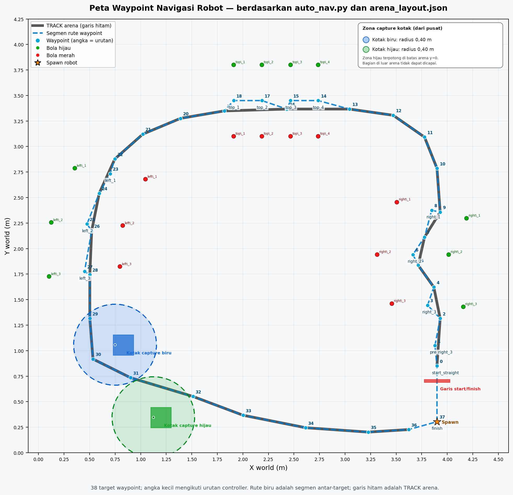
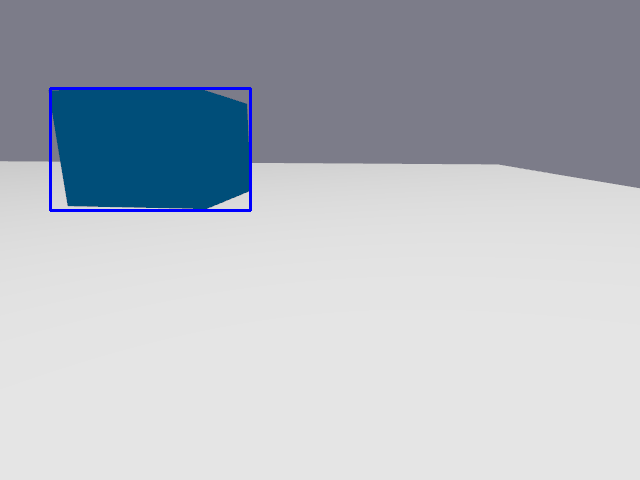
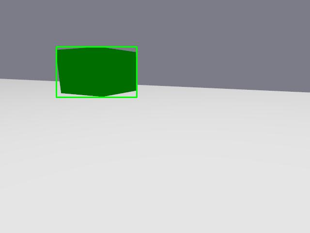

# ATS-502 Autonomous ASV — Simulasi Robot Mobile ROS 2

## Deskripsi

Proyek ini berisi simulasi robot mobile diferensial menggunakan **ROS 2 Jazzy**, **Gazebo Sim**, dan **RViz2**. Robot mengikuti lintasan arena dengan Pure Pursuit, membaca pose dari odometri dan TF, menampilkan keadaan arena di RViz2, serta mendeteksi dan menyimpan gambar kotak biru dan hijau dari kamera robot.

Arena, waypoint, model robot, dan konfigurasi visualisasi disertakan agar proyek dapat diunduh dan dipelajari oleh anggota tim. Gambar contoh hasil kamera tersedia di `captured_images/`.

## Arsitektur

```mermaid
flowchart LR
    A["generate_arena.py<br/>layout sumber"] --> B["worlds/arena.world<br/>config/arena_layout.json"]
    B --> C["Gazebo Sim<br/>fisika, robot, sensor kamera"]
    C <--> D["ros_gz_bridge"]
    D -->|"/odom, /tf, /camera/image_raw"| E["auto_nav.py<br/>Pure Pursuit + safety"]
    E -->|"/cmd_vel"| D
    E -->|"/nav/active_waypoint"| F["camera_capture.py"]
    D -->|"/camera/image_raw"| F
    F -->|"/camera/detections/image_raw"| G["rqt_image_view"]
    F -->|PNG + JSON"| H["captured_images/"]
    D --> I["RViz2<br/>robot, TF, arena, waypoint"]
```

### Alur dan topik utama

- `generate_arena.py` adalah sumber koordinat arena. Script ini membuat `worlds/arena.world` dan `config/arena_layout.json`.
- Plugin `DiffDrive` di Gazebo menerima `/cmd_vel` dan menghasilkan `/odom` serta TF `odom → base_footprint`.
- `run_rviz.sh` menjalankan bridge, menerbitkan TF statis `world → odom`, memulai `robot_state_publisher`, marker arena, dan RViz2.
- `scripts/auto_nav.py` mengikuti waypoint arena dengan Pure Pursuit. Nama waypoint aktif diterbitkan pada `/nav/active_waypoint`.
- Kamera Gazebo menerbitkan `/camera/image_raw` pada 15 Hz. `scripts/camera_capture.py` mendeteksi kotak berwarna dan menerbitkan overlay ke `/camera/detections/image_raw`.
- Capture hanya dilakukan saat waypoint foto yang ditentukan aktif **dan** detektor mengenali kotak dengan warna yang sesuai. Pemicu saat ini:
  - Biru: waypoint peta 29–30 (`track_18`, `track_19`).
  - Hijau: waypoint peta 31–32 (`track_20`, `track_21`).
- Satu foto dapat disimpan pada setiap waypoint foto, sehingga maksimal dua foto per warna dalam satu perjalanan rute. Gambar dan metadata disimpan di `captured_images/`.
- Safety controller navigasi memeriksa bola statis yang tercantum di layout. Sistem ini bukan detektor rintangan umum untuk objek tak dikenal atau bergerak.

## Struktur folder

```text
.
├── README.md
├── .gitignore
├── generate_arena.py             # Generator world dan layout arena
├── run_all.sh                    # Menjalankan seluruh komponen dengan terminal GUI
├── run_sim.sh                    # Menjalankan Gazebo Sim
├── run_rviz.sh                   # Bridge, TF, robot state, marker, RViz2
├── run_nav.sh                    # Navigasi waypoint
├── run_camera.sh                 # Detektor kamera dan viewer overlay
├── config/
│   ├── arena_layout.json         # Koordinat arena hasil generator
│   └── arena_rviz.rviz           # Konfigurasi RViz2
├── models/robot/
│   ├── model.config
│   ├── model.sdf                 # Model, differential drive, sensor kamera
│   └── meshes/                   # Mesh badan robot
├── scripts/
│   ├── auto_nav.py               # Waypoint, Pure Pursuit, safety, status navigasi
│   ├── camera_capture.py         # Deteksi kotak, trigger waypoint, penyimpanan
│   ├── arena_markers_pub.py      # Marker arena untuk RViz2
│   └── robot_description_pub.py  # Publisher deskripsi robot
├── urdf/
│   └── robot.urdf                # Model robot untuk robot_state_publisher
├── worlds/
│   └── arena.world               # World Gazebo hasil generator
├── captured_images/
│   ├── blue_box/                 # Contoh PNG dan metadata JSON kotak biru
│   └── green_box/                # Contoh PNG dan metadata JSON kotak hijau
├── waypoint_map.png              # Peta waypoint dan zona capture
└── tools/                         # Utilitas mesh dan visualisasi robot
```

`urdf/robot_resolved.urdf` dibuat otomatis oleh `run_rviz.sh` dari `urdf/robot.urdf`; file hasil tersebut tidak perlu diunggah karena berisi path mesh spesifik mesin.

## Persyaratan

- Ubuntu 24.04 LTS
- ROS 2 Jazzy
- Gazebo Sim yang kompatibel dengan paket ROS-Gazebo Jazzy
- Lingkungan desktop Linux untuk Gazebo GUI, RViz2, dan `rqt_image_view`
- Koneksi internet untuk instalasi paket ROS

## Instalasi di Ubuntu 24.04

### 1. Pasang ROS 2 Jazzy

Ikuti panduan resmi instalasi ROS 2 Jazzy untuk Ubuntu 24.04:

<https://docs.ros.org/en/jazzy/Installation/Ubuntu-Install-Debs.html>

Pastikan repository ROS 2 sudah dikonfigurasi, lalu pasang paket yang dipakai proyek:

```bash
sudo apt update
sudo apt install -y \
  ros-jazzy-desktop \
  ros-jazzy-ros-gz \
  ros-jazzy-ros-gz-sim \
  ros-jazzy-ros-gz-bridge \
  ros-jazzy-cv-bridge \
  ros-jazzy-rqt-image-view \
  python3-opencv \
  python3-numpy \
  gnome-terminal
```

### 2. Unduh proyek

```bash
git clone https://github.com/YannSipemalas/ATS-502-AUTONOMOUS-ASV.git
cd ATS-502-AUTONOMOUS-ASV
```

### 3. Jalankan seluruh simulasi

```bash
source /opt/ros/jazzy/setup.bash
bash run_all.sh
```

`run_all.sh` membuka terminal terpisah untuk Gazebo, RViz2, kamera, dan navigasi. Pastikan setiap komponen selesai mulai sebelum menjalankan langkah berikutnya; script sudah memberi jeda singkat antar-terminal.

### Menjalankan komponen secara manual

Jika ingin melihat log setiap komponen secara terpisah, buka empat terminal di folder proyek. Jalankan perintah berikut secara berurutan:

```bash
# Terminal 1: Gazebo dan arena
source /opt/ros/jazzy/setup.bash
bash run_sim.sh
```

```bash
# Terminal 2: bridge, TF, robot state, marker arena, dan RViz2
source /opt/ros/jazzy/setup.bash
bash run_rviz.sh
```

```bash
# Terminal 3: kamera, deteksi, dan viewer overlay
source /opt/ros/jazzy/setup.bash
bash run_camera.sh
```

```bash
# Terminal 4: navigasi waypoint
source /opt/ros/jazzy/setup.bash
bash run_nav.sh
```

Untuk menghentikan, tekan `Ctrl+C` pada terminal komponen yang sedang berjalan.

## Memeriksa topik dan hasil capture

```bash
source /opt/ros/jazzy/setup.bash
ros2 topic list
ros2 topic hz /camera/image_raw
ros2 topic echo /nav/active_waypoint
find captured_images -type f
```

- Overlay deteksi kamera: `/camera/detections/image_raw`
- Citra kamera mentah: `/camera/image_raw`
- Perintah kecepatan: `/cmd_vel`
- Odometri: `/odom`
- Status waypoint aktif: `/nav/active_waypoint`
- Foto kotak biru: `captured_images/blue_box/`
- Foto kotak hijau: `captured_images/green_box/`

Nama file foto berisi tanggal, waktu lokal, offset zona waktu, warna, dan nomor urut. Berkas JSON pasangannya mencatat waktu, topik kamera, pose robot jika TF tersedia, waypoint pemicu, dan informasi deteksi.

## Bukti visual

Peta rute dan waypoint:



Contoh hasil foto kotak biru:



Contoh hasil foto kotak hijau:



## Catatan

- Folder `captured_images/` berisi sampel hasil simulasi untuk dokumentasi. Hasil run berikutnya ditambahkan dengan timestamp baru.
- `worlds/arena.world` dan `config/arena_layout.json` dapat dibuat ulang dengan menjalankan `python3 generate_arena.py`.
- Pastikan hanya ada satu instance Gazebo, bridge, navigasi, dan node kamera untuk workspace ini.
- Proyek menggunakan script ROS 2 Python langsung dan bukan paket `colcon`; tidak ada langkah `colcon build`.
